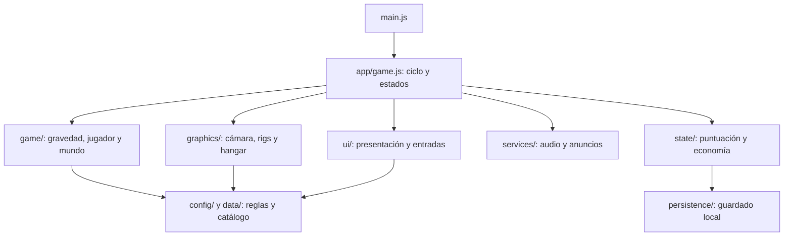

# Arquitectura

La aplicación usa módulos ES con dependencias explícitas. No necesita un framework de interfaz ni un servidor de juego. Three.js se fija en 0.128.0 para conservar las geometrías y APIs del juego original; esbuild produce el JavaScript de distribución.

## Responsabilidades

- `src/main.js`: arranque y mensaje si WebGL no puede iniciarse.
- `src/app/game.js`: composición, estados MENU/COUNTDOWN/PLAYING/PAUSED/GAMEOVER y avance de la simulación. Recibe fábricas de renderer y hangar para probar el ciclo sin GPU.
- `src/game/`: simulación y colisiones. No importa la interfaz.
- `src/graphics/`: construcción y destrucción de modelos, cámara y vista del hangar.
- `src/ui/game-ui.js`: DOM, HUD, tienda y exportación. Su estado de selección es independiente del estado de partida.
- `src/ui/input-controller.js`: traduce teclado, gestos y botones en acciones de la aplicación; no actualiza la física.
- `src/state/score-manager.js`: puntuación, economía, reto y validación del guardado. Recibe un adaptador de persistencia opcional.
- `src/persistence/browser-save-store.js`: frontera con localStorage, con fallos de acceso y cuota tolerados.
- `src/services/`: audio y proveedor publicitario. Los anuncios requieren integración real y callback de recompensa.
- `src/config/`, `src/data/`: paleta, dimensiones, superficies y catálogo de chasis.

La interfaz tiene una referencia al coordinador para enviar acciones y consultar datos; el coordinador la construye mediante composición. Los módulos de simulación no conocen la interfaz. Las pruebas detectan ciclos entre imports y dependencias desde simulación hacia UI.

## Fuentes y distribución

Edita `src/` y `styles.css`. `npm run build` empaqueta Three.js y genera `game.js`, `index.html` y `dist/`; estos productos no son fuentes editables y se excluyen de Git. El HTML generado conserva la descarga del juego desde el menú. El archivo ZIP de fuentes permite reconstruir el proyecto con `npm ci`.

Tailwind se compila durante el build. Font Awesome y las fuentes WOFF2 se copian desde dependencias locales. El motor Three.js ya va dentro del bundle y no necesita un script remoto. No hay backend ni sincronización de partidas entre dispositivos. Las cuentas, rankings remotos, telemetría y SDKs de tiendas se añadirían como adaptadores independientes.

## Validación

`npm run check` ejecuta las pruebas y la compilación. Las pruebas cubren economía, guardado, colisiones a 20 FPS, ciclo de vida del mundo, controles del DOM, composición real de la aplicación y límites de módulos. El renderer se sustituye por un doble en la prueba de composición: esta prueba no demuestra que WebGL renderice correctamente. Antes de lanzar a las tiendas hay que probar navegadores y dispositivos reales.

## Reglas y contenido de partida

`data/run-content.js` declara zonas, secuencias y hazañas. `ProceduralWorld` compone filas con una salida segura y monedas guía. `game/shift-judge.js` decide si una salida temporizada es perfecta y marca el obstáculo para impedir dobles recompensas. `ScoreManager` mantiene tiempo activo, economía y desbloqueos; la UI consulta estos datos.

`graphics/zone-controller.js` mezcla luz y color al cambiar de sector. `services/audio.js` selecciona la línea musical del sector. `graphics/human-motion.js` convierte el modelo de marcha en clips reutilizables y gestiona su mezcla con AnimationMixer; la simulación de gravedad continúa siendo independiente de la animación visual.

La continuación pasa por una única acción del coordinador, tanto si cuesta energía como si llega de un callback publicitario válido. El adaptador de anuncios liquida cada solicitud una sola vez. El coordinador usa un identificador de partida para descartar recompensas tardías cuando el jugador ya ha reintentado.

## Orden de efectos y colisiones

En cada paso fijo se detecta un candidato a cambio perfecto y se resuelven las colisiones antes de confirmar su recompensa. Un paso mortal no emite feedback de éxito. La salida de PLAYING limpia los efectos transitorios mediante GameUI y cancela los sonidos pendientes de AudioManager. Las pruebas cubren tanto muerte en el mismo paso como muerte con el cartel ya visible y el reinicio posterior.

## Modos, entrada y persistencia portátil

`input/swipe-gesture.js` reconoce una acción por gesto al cruzar el umbral; InputController la traduce a acciones del coordinador. La reanudación usa un estado RESUMING independiente, sin avanzar física ni puntuación durante la cuenta atrás.

`game/practice-controller.js` declara seis ejercicios y reutiliza movimiento, monedas, colisiones y evaluación de precisión reales. `ScoreManager.mode` impide que práctica y reto diario modifiquen economía, hazañas o récords normales. El reto registra únicamente su récord por fecha mediante `game/daily-challenge.js`; la misma fecha produce la misma semilla, con calendario Europe/Madrid explícito. Compartir un enlace no cambia el acceso al sitio.

`graphics/adaptive-quality.js` mide ventanas de fotogramas con histéresis y ajusta el renderer y la cantidad de partículas sin tocar las reglas de simulación. ProceduralWorld recicla mallas en pools acotados por tipo y reinicia sus transformaciones y metadatos al reutilizarlas.

`persistence/save-backup.js` valida una lista explícita de campos y el formato de las copias. BrowserSaveStore informa del estado de lectura/escritura; un fallo conserva los datos de sesión. La importación solo sustituye el perfil tras validación y confirmación. Las pruebas cubren separación de modos, gesto temprano, pausa segura, pools, calidad adaptativa, semillas, enlaces e importación cancelada.

## Plataformas y recursos instalables

`graphics/captured-character.js` carga el GLB licenciado, clona su esqueleto y geometría por personaje, vincula accesorios a huesos y administra AnimationMixer. El cuerpo usa un material exclusivo con `skinning`; compartirlo con accesorios rígidos en Three r128 puede reutilizar el shader sin deformación y dejar la malla en T-pose. `skeletal-gait.js` orienta los huesos del modelo, conserva la torsión, resuelve el apoyo de piernas con dos segmentos y mezcla flexión de brazos, recogida aérea y amortiguación. Los sockets solo siguen el resultado, no sustituyen la animación del esqueleto. `human-motion.js` queda como reserva ante un fallo del recurso.

`platform/install.js` administra instalación, estado offline y actualización voluntaria. El build genera un service worker con versión por hash de contenido. `native/admob-provider.js` es la frontera con el SDK opcional de prueba; el juego no depende directamente de eventos nativos. `services/haptic-feedback.js` abstrae vibración web/nativa. `services/playtest-metrics.js` mantiene mediciones locales acotadas y exportación sin red.

`android/`, `ios/` y `capacitor.config.json` contienen los proyectos nativos. Actions compila versiones de prueba sin claves comerciales y ejecuta Chromium con WebGL para comprobar cámara, esqueleto, prioridad de derrota y carga offline. No demuestra rendimiento de dispositivos físicos.

## Traje del corredor

`graphics/runner-suit.js` construye la carcasa sobre el cuerpo deformable: el tejido usa material mate independiente, las placas tienen cantos redondeados y las piezas largas se orientan entre pares de huesos. Casco y botas tienen marcos específicos para evitar heredar torsiones ajenas a su anatomía. Se mantienen cinco familias de diseño sin duplicar el controlador de movimiento. La posición de contacto se alinea con los planos reales del túnel; una sombra discreta desaparece durante las transferencias. Las capturas de Actions incluyen revisión frontal de las cinco familias y carrera en móvil.

## Entrada, tiempo y colisiones

GravitySystem guarda una única orden pendiente; repetir el destino actual la cancela. El HUD muestra esa intención con un indicador y un contorno discontinuo. La física sigue usando pasos de 1/120 s y consume el tiempo real del fotograma hasta un segundo; una interrupción superior pausa la partida. El cuerpo visual se actualiza una vez por fotograma, mientras la posición física y orientación se actualizan en cada paso.

`game/collision-shapes.js` cruza una cápsula corporal de radio 0,18 m con formas locales de barreras, postes y haces de láser, placas de peligro y brazos giratorios finitos. La orientación proviene del cuaternión actual, también en vuelo. Las skins no cambian esa cápsula. El contacto calculado queda en el obstáculo para la revisión de la derrota.

## Revisión de derrota y avisos

`graphics/run-replay.js` conserva como máximo 40 muestras del último segundo, solo en memoria. Su estado REPLAY interpola las transformaciones registradas y resalta el obstáculo y el contacto. No ejecuta física, recompensas ni finalización. Al terminar o cerrar restaura las transformaciones, visibilidad y estado GAMEOVER. No hay grabación de vídeo ni subida de datos.

`services/notification-queue.js` limita los avisos, agrupa duplicados y permite que desbloqueos o recompensas interrumpan avisos menores. Pausar, morir y reiniciar vacían la cola. La advertencia de peligro continúa siendo independiente.

## Contenido y objetivos posteriores

El catálogo contiene diez secuencias, incluidas secuencias de cuatro pasos, intervalos rítmicos y bifurcaciones posteriores a 300 m con dos salidas señalizadas. Cada salida marcada conserva su ruta de monedas libre de obstáculos en esa fila. El reto inicial sigue siendo 250 m y +75 de energía. Después, `game/run-contracts.js` alterna objetivos relativos de distancia, monedas y cambios perfectos, con dificultad creciente. Solo el modo normal entrega estas recompensas, una vez por objetivo y partida.

`data/skin-styles.js` define cinco familias visuales. Las piezas pesadas, capuchas, faldones, aletas y cuellos facetados se vinculan a los marcos del traje. No alteran velocidad, tamaño de colisión ni economía. El hangar identifica la familia en vez de mostrar recuentos técnicos de mallas.

## Objetos, tienda y corredores raros

`data/items.js` declara cuatro objetos, costes y compras validadas. `game/run-items.js` administra sus temporizadores en pasos físicos, salto, tabla de un solo impacto y puntos ×2. El imán mueve monedas reales a su radio de recogida; no añade energía ficticia. Superbotas cambia la altura del siguiente salto y mantiene esa altura hasta aterrizar, aunque expire el efecto en el aire. Los objetos se generan sobre las rutas seguras y se reciclan en pools acotados.

`ui/workshop.js` ofrece mejoras permanentes de duración (tres niveles por objeto) y tablas de reserva por energía del juego. Perfil y copias incluyen niveles e inventario validados. Solo el modo normal usa compras y mejoras; el diario conserva objetos y duraciones base iguales para todos, y la práctica mantiene sus ejercicios aislados.

`game/rare-runners.js` hace una comprobación del 0,6 % cada 120 m, a partir de 180 m, con un máximo de un corredor por partida normal. Elige una skin todavía bloqueada. Su velocidad es el 88 % de la del jugador; anticipa las filas de obstáculos y cambia de superficie para esquivarlas. Una comprobación de seguridad busca una superficie libre si la trayectoria llega a solaparse con un obstáculo. La captura requiere proximidad real y concede la skin sin coste ni cambio automático de traje; el desbloqueo persiste tras la derrota. No aparecen en práctica ni en el reto diario. La probabilidad se aplica por comprobación, no por partida.
