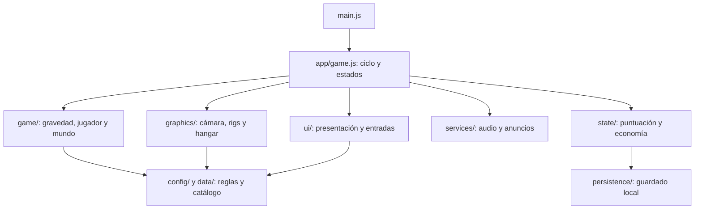

# Arquitectura

La aplicación usa módulos ES con dependencias explícitas. No necesita un framework de interfaz ni un servidor de juego. Three.js se fija en 0.128.0 para conservar las geometrías y APIs del juego original; esbuild produce el JavaScript de distribución.

## Responsabilidades

- `src/main.js`: arranque y mensaje si WebGL no puede iniciarse.
- `src/app/game.js`: composición, estados MENU/COUNTDOWN/PLAYING/PAUSED/GAMEOVER y avance de la simulación. Recibe fábricas de renderer y hangar para probar el ciclo sin GPU.
- `src/game/`: simulación y colisiones. No importa la interfaz.
- `src/graphics/`: construcción y destrucción de modelos, cámara y vista del hangar.
- `src/ui/game-ui.js`: DOM, HUD, tienda y exportación. Su estado de selección es independiente del estado de partida.
- `src/ui/input-controller.js`: traduce teclado, gestos y botones en acciones de la aplicación; no actualiza la física.
- `src/state/score-manager.js`: puntuación, economía, reto y validación del guardado. Recibe un adaptador de persistencia opcional.
- `src/persistence/browser-save-store.js`: frontera con localStorage, con fallos de acceso y cuota tolerados.
- `src/services/`: audio y proveedor publicitario. Los anuncios requieren integración real y callback de recompensa.
- `src/config/`, `src/data/`: paleta, dimensiones, superficies y catálogo de chasis.

La interfaz tiene una referencia al coordinador para enviar acciones y consultar datos; el coordinador la construye mediante composición. Los módulos de simulación no conocen la interfaz. Las pruebas detectan ciclos entre imports y dependencias desde simulación hacia UI.

## Fuentes y distribución

Edita `src/` y `styles.css`. `npm run build` empaqueta Three.js y genera `game.js`, `index.html` y `dist/`; estos productos no son fuentes editables y se excluyen de Git. El HTML generado conserva la descarga del juego desde el menú. El archivo ZIP de fuentes permite reconstruir el proyecto con `npm ci`.

Tailwind se compila durante el build. Font Awesome y Google Fonts se descargan de CDN. El motor Three.js ya va dentro del bundle y no necesita un script remoto. No hay backend ni sincronización de partidas entre dispositivos. Las cuentas, rankings remotos, telemetría y SDKs de tiendas se añadirían como adaptadores independientes.

## Validación

`npm run check` ejecuta las pruebas y la compilación. Las pruebas cubren economía, guardado, colisiones a 20 FPS, ciclo de vida del mundo, controles del DOM, composición real de la aplicación y límites de módulos. El renderer se sustituye por un doble en la prueba de composición: esta prueba no demuestra que WebGL renderice correctamente. Antes de lanzar a las tiendas hay que probar navegadores y dispositivos reales.

## Reglas y contenido de partida

`data/run-content.js` declara zonas, secuencias y hazañas. `ProceduralWorld` compone filas con una salida segura y monedas guía. `game/shift-judge.js` decide si una salida temporizada es perfecta y marca el obstáculo para impedir dobles recompensas. `ScoreManager` mantiene tiempo activo, economía y desbloqueos; la UI consulta estos datos.

`graphics/zone-controller.js` mezcla luz y color al cambiar de sector. `services/audio.js` selecciona la línea musical del sector. `graphics/human-motion.js` convierte el modelo de marcha en clips reutilizables y gestiona su mezcla con AnimationMixer; la simulación de gravedad continúa siendo independiente de la animación visual.

La continuación pasa por una única acción del coordinador, tanto si cuesta energía como si llega de un callback publicitario válido. El adaptador de anuncios liquida cada solicitud una sola vez. El coordinador usa un identificador de partida para descartar recompensas tardías cuando el jugador ya ha reintentado.

## Orden de efectos y colisiones

En cada paso fijo se detecta un candidato a cambio perfecto y se resuelven las colisiones antes de confirmar su recompensa. Un paso mortal no emite feedback de éxito. La salida de PLAYING limpia los efectos transitorios mediante GameUI y cancela los sonidos pendientes de AudioManager. Las pruebas cubren tanto muerte en el mismo paso como muerte con el cartel ya visible y el reinicio posterior.
